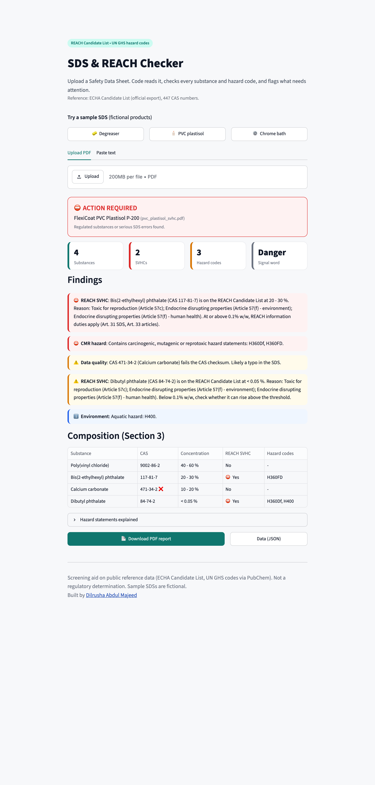

# SDS & REACH Checker

Upload a Safety Data Sheet (PDF) and get an instant screening report against the official EU REACH Candidate List and the UN GHS hazard codes.



**Example output:** [one-page PDF report](docs/example-report-chrome-bath.pdf) for a chrome-plating bath SDS with a wrong signal word.

## What it checks

- **REACH SVHC:** every CAS number in Section 3 is matched against the ECHA Candidate List (official export, 447 CAS numbers). The 0.1% w/w threshold is applied (REACH Art. 31 and 33).
- **Hazard profile:** H-codes are decoded with the UN GHS list and grouped into CMR, acute toxicity and environment.
- **SDS quality:** CAS checksum validation (catches typos), signal word consistency ("Warning" where "Danger" is required), missing concentrations, missing sections.
- **Output:** verdict (ACTION REQUIRED / REVIEW / NO FLAGS), findings ranked by severity, a downloadable PDF report, and JSON data for other systems.
- **Optional AI summary:** plain-English summary by Claude, given only the findings.

**Design principle: code decides, AI only explains.** Extraction and every check are deterministic Python (regex, CAS checksum, exact lookups). The AI summary cannot add substances, limits or hazards.

## Try it

Three fictional sample SDSs are included in `samples/`:

| Sample | What it shows |
|---|---|
| Degreaser | Clean result, no flags |
| PVC plastisol | DEHP above 0.1% (high), DBP below 0.1% (medium), CAS typo on calcium carbonate |
| Chrome bath | Chromium trioxide SVHC, CMR hazards, signal word "Warning" where "Danger" is required |

```bash
python -m venv .venv && .venv/bin/pip install -r requirements.txt
.venv/bin/streamlit run app.py      # then open /?sample=chrome_bath_errors
.venv/bin/python -m pytest -q       # 12 tests
```

## Project structure

| File | Purpose |
|---|---|
| `checker.py` | Core engine: PDF text, section split, CAS and concentration parsing, all checks |
| `app.py` | Streamlit interface |
| `report_pdf.py` | Printable PDF report |
| `tests/test_checker.py` | Tests for checksums, concentrations, the three samples and false positives |
| `samples/make_samples.py` | Generates the fictional sample SDSs |

## Reference data

| File | Source |
|---|---|
| `data/svhc_candidate_list.xlsx` | Official export of the [ECHA Candidate List](https://echa.europa.eu/candidate-list-table) |
| `data/ghs_hazard_statements.csv` | UN GHS hazard statements, via PubChem |
| `data/svhc_sample.csv` | 27 well-known SVHCs, used only if the official export is missing |

## Limits

- Screening aid only, not a regulatory determination.
- Works on digital (text) PDFs. Scanned SDSs need OCR first.
- SDS layouts vary. Section 3 parsing is best effort and the report says what it could not read.

## Next steps

REACH Annex XVII restrictions, GCC and UAE chemical lists, batch mode for many SDSs with a supplier dashboard.

---
Built by [Dilrusha Abdul Majeed](https://dilrushabdulmajeed-lang.github.io/dilrusha-portfolio-v2/). Sample SDSs are fictional.
